# KKOBIT | 꼬빛 🐾

**반려동물의 일상, 돌봄, 성장, 추억을 하나로 연결하는 모바일 앱**

`Flutter` · `Dart` · `Supabase` · `PostgreSQL` · `Firebase Cloud Messaging` · `NAVER Maps`

> **개발 진행 중 (2026년 11월 기준)** — 주요 기능 구현 및 Android 디버그 빌드 확인, STAGING 서버 보안·연동 검증 진행 중. 상용 출시 전 단계입니다.

## 프로젝트 소개

**KKOBIT(꼬빛)**은 반려동물의 돌봄과 건강 기록, 성장·미션, 지도에 남기는 추억, 개인 공간의 상호작용을 하나의 모바일 경험으로 구현하기 위한 프로젝트입니다. 앱 기능과 사용자 데이터 보호를 함께 고려하며 개발하고 있습니다.

## 실제 앱 실행 화면

> 아래 이미지는 개발 과정에서 확보한 **앱 실행 화면 캡처**입니다. 개발 시점별 화면이 섞여 있어 최신 빌드의 UI와 일부 다를 수 있습니다. 개인 데이터나 운영 서버 관리 화면은 공개하지 않았습니다.

| 오늘의 돌봄 | 성장 레벨 |
|:--:|:--:|
| 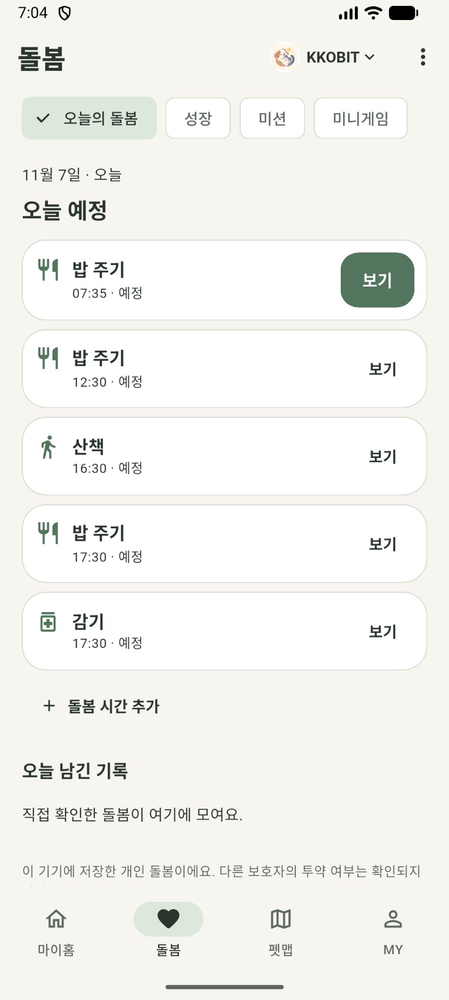 | 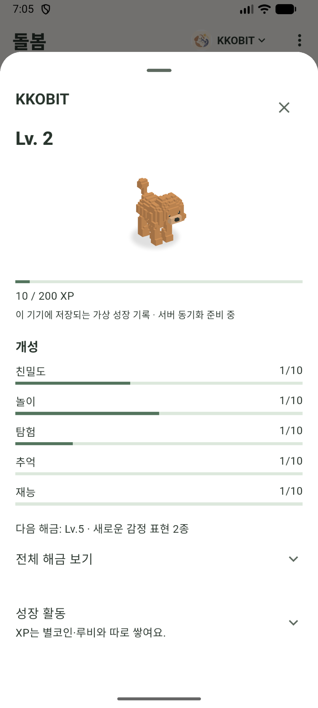 |

| 성장 상세 | 미션 관리 |
|:--:|:--:|
| 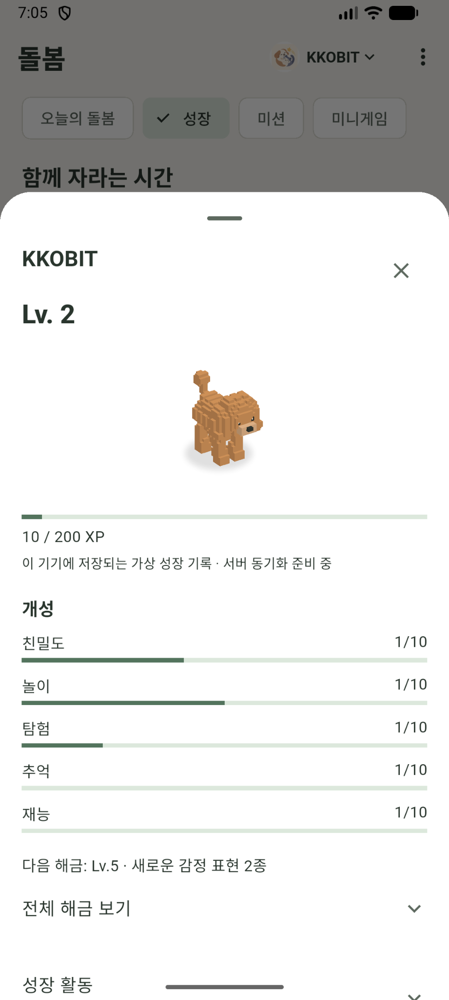 | 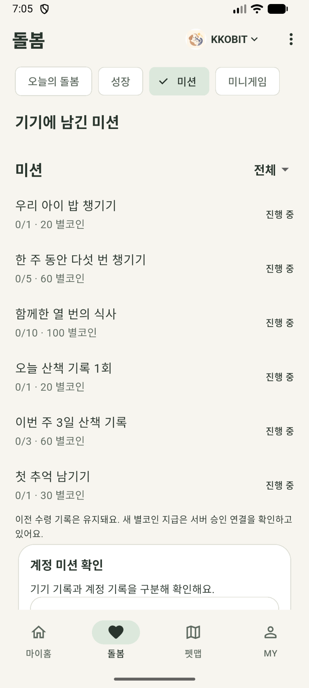 |

| 미니게임: 오목 | 미니게임: 알까기 |
|:--:|:--:|
| 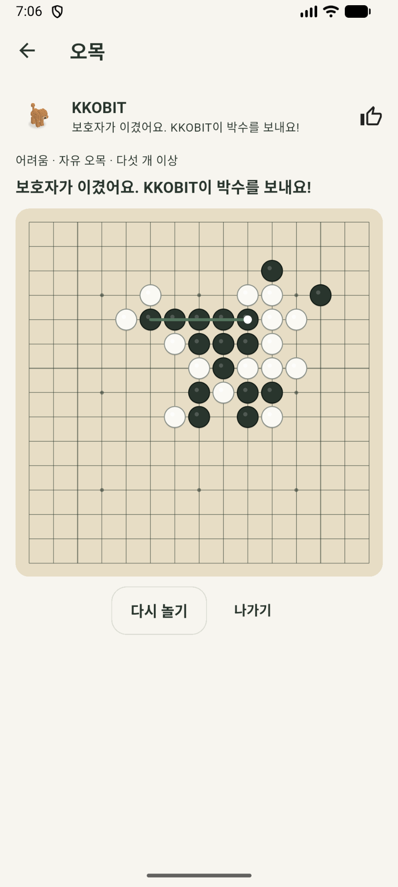 | 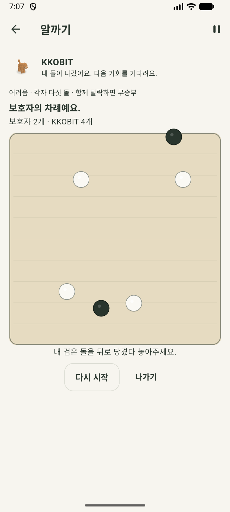 |

| 건강 일정 | 건강·체중 기록 |
|:--:|:--:|
| 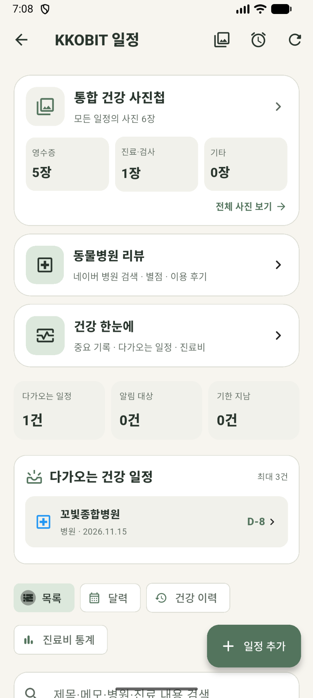 | 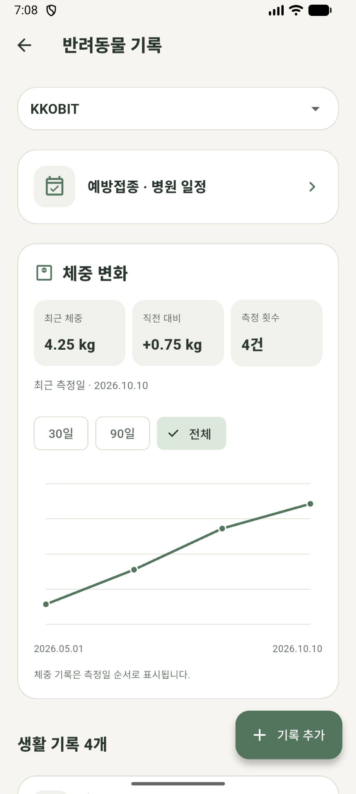 |

| 성장 진행 화면 | 펫맵: 기록 지도 |
|:--:|:--:|
| 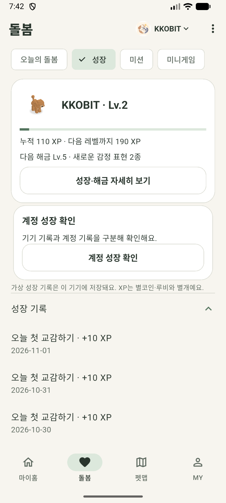 | 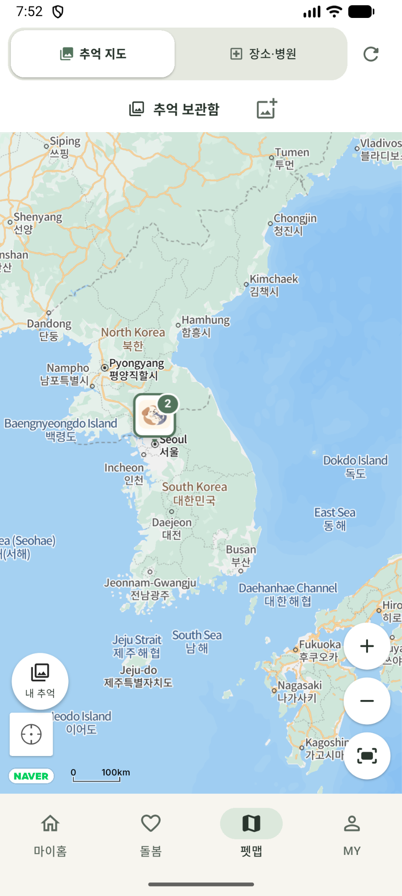 |

| 펫맵: 주변 장소 | 펫맵: 장소 목록 |
|:--:|:--:|
| 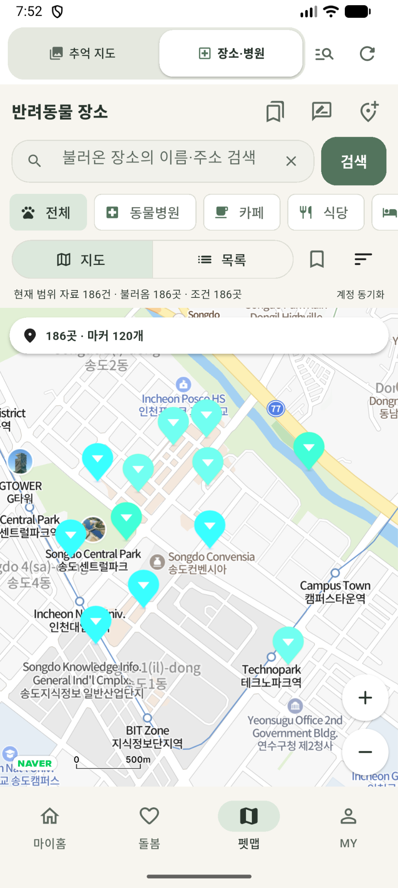 | 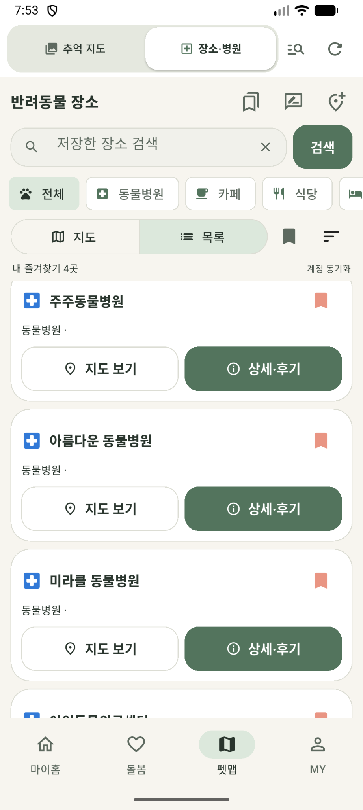 |

| 펫맵: 추억 카드 |  |
|:--:|:--:|
| 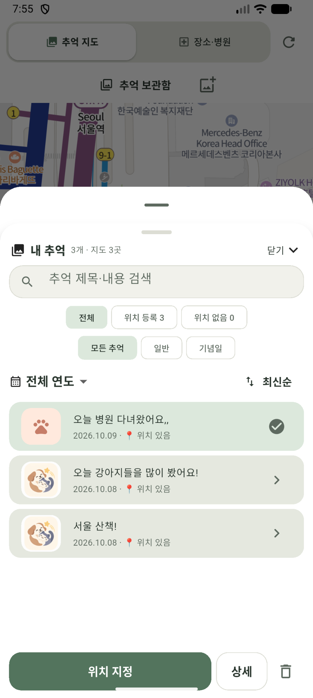 |  |


### 포트폴리오용 목업 프리뷰

아래 이미지는 위 실제 화면을 소개하기 위한 **프레젠테이션 목업**입니다. 앱 화면의 검증 증빙은 위 원본 캡처를 기준으로 확인할 수 있습니다.

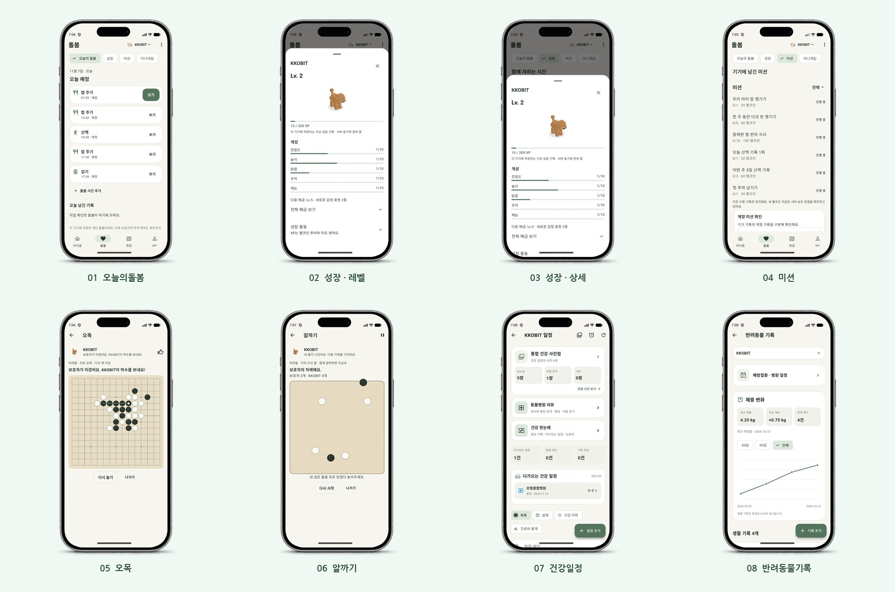

## 주요 기능

- **마이홈**: 반려동물 캐릭터와 상호작용하는 개인 공간 및 꾸미기
- **돌봄**: 돌봄 일정, 건강 관련 기록, 사진 기록 관리
- **성장·미션**: XP, 레벨, 성장 과정, 미션 및 보상 시스템
- **미니게임**: 오목, 알까기 등 앱 내부 게임 요소
- **펫맵**: 지도 기반 추억 기록과 주변 장소 탐색
- **MY**: 계정, 사용자 설정 및 테마 관리

> 기능별 구현·검증·개선 상태는 계속 변동합니다. 본 포트폴리오는 완성된 상용 앱을 홍보하는 자료가 아니라 개발 과정과 결과를 보여주는 문서입니다.

## 기술 스택과 구성

| 영역 | 기술 및 사용 목적 |
|---|---|
| 모바일 | Flutter, Dart — Android/iOS 앱 UI 및 기능 |
| 인증·서버 | Supabase Auth, PostgREST — 계정 인증 및 API |
| 데이터베이스 | PostgreSQL, Row Level Security(RLS) — 데이터 모델 및 접근 통제 |
| 사진 저장 | Supabase Storage — 앱 파일 저장 연동, 접근 검증 진행 중 |
| 알림 | Firebase Cloud Messaging — 일정 등 알림 |
| 지도 | NAVER Maps — 위치·기록 기반 지도 화면 |
| 개발 도구 | Android Studio, VS Code, Git/GitHub |

### 서버 구조 개요

```text
Flutter Mobile App
 ├─ Supabase Auth           로그인·세션
 ├─ Supabase REST / RPC     돌봄·추억·성장 데이터
 │   └─ PostgreSQL / RLS    사용자별 데이터 접근 통제
 ├─ Supabase Storage        사진·첨부파일 (검증 진행 중)
 ├─ Firebase FCM            알림
 └─ NAVER Maps              지도·장소
```

## 개발 및 검증 기록

| 항목 | 확인된 내용 |
|---|---|
| Android 디버그 빌드 | 빌드 실행 확인 |
| Flutter 로컬 자동화 테스트 | **1,810건 통과, 5건 건너뜀** (당시 실행 기준) |
| 독립 STAGING 환경 | 운영 환경과 별도로 구성 |
| STAGING 앱 DB 구조 | 대상 스키마 5개, 테이블 70개 확인 |
| RLS | 70개 테이블 활성화, 정책 112개 확인 (설치 당시 기준) |
| 실제 계정 로그인 | STAGING 테스트 계정 로그인 성공 |
| 관리자 API | 일반 테스트 계정에서 조회 RPC 2개 접근 거부 확인 |
| 관리자 RPC 익명 권한 | 대상 12개 함수의 익명 실행 권한 차단 확인 |
| 반려동물 추억 소유권 | STAGING에서 타인 반려동물 연결 차단 정책 적용 및 시험 결과 확인 |
| RLS 조회·쓰기 시험 | 임시 데이터 롤백 확인. 전체 API 기반 교차 계정 검증은 추가 진행 필요 |

**보안 검증 범위에 관한 주의:** 정책 개수나 테스트용 SQL의 롤백 성공만으로 전체 보안성을 입증할 수는 없습니다. 다른 사용자 JWT를 이용한 API 교차 검증, Storage, 계정 삭제·개인정보 보존, 실제 운영 반영은 별도 검증 대상입니다.

## 개발 과정에서 고려한 문제

1. **제품 기능과 서버 권한의 분리** — 운영 DB에 직접 시험하지 않고 별도 STAGING 환경에서 SQL 및 REST API를 검증
2. **개인별 접근 제어** — 반려동물 소유자, 추억 작성자, 공개 범위를 구분하는 RLS 정책 설계 및 점검
3. **복수 기능 통합** — 돌봄, 성장·보상, 기록, 지도, 미니게임을 모바일 인터페이스로 연결
4. **점진적 검증** — 로컬 자동화 테스트, 앱 빌드, 실제 테스트 계정의 서버 연동을 단계적으로 확인

## 다음 검증 및 개선 작업

- 실제 사용자 A/B 토큰 기반 교차 계정 API 검증
- Storage 버킷, 사진·첨부파일 접근 권한 검증
- 회원탈퇴, 데이터 삭제 및 최소 보존 정책 검토
- 실기기 알림·딥링크, Android/iOS 출시 점검
- 앱 화면 개선과 사용성 테스트

---

이 저장소는 **개발 성과 소개용 공개 포트폴리오**입니다. 전체 앱 소스코드, 프로젝트 키, DB 덤프, 실제 사용자 개인정보, 운영 서버 접속정보는 포함하지 않습니다.
